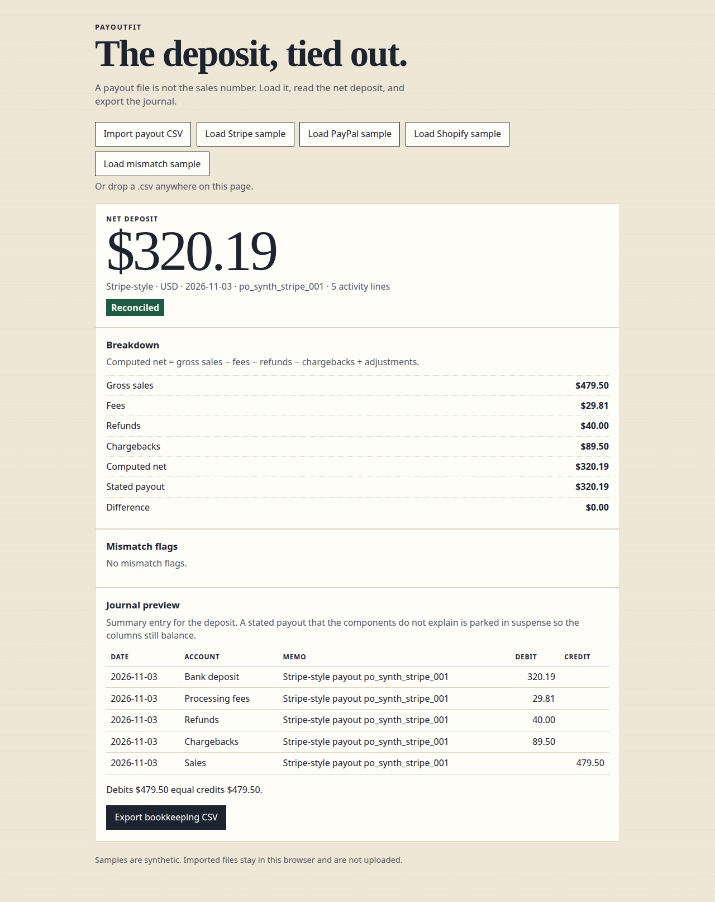
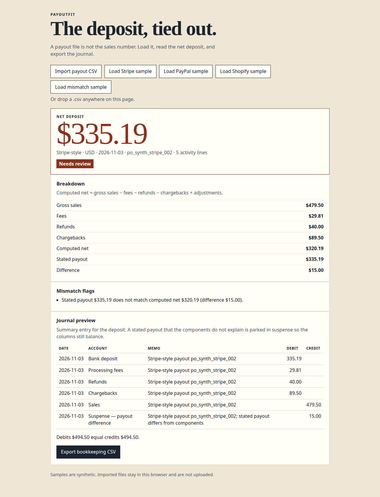

# PayoutFit

Freelance bookkeepers receive a processor payout export in which the bank deposit is not the gross sales figure. Fees, refunds, and chargebacks are in the same file. PayoutFit ties that file out on one screen and writes a journal CSV.

Author: Igor Eduardo (igoreduardoai). Built for the Kane CLI Online Hackathon. Submission deadline 26 November 2026, 10:29 AM PT (12:29 PM America/Chicago). An organizer email on 18 November 2026 extended the deadline. The hackathon page read on 14 November 2026 showed 19 November 2026, 10:29 AM PT.

## 5-second explanation

Load a payout CSV. The big number is the net deposit. Export the journal.

## One command for a judge

Install dependencies once, then start the built app:

```bash
npm install
npm start
```

`npm start` typechecks, builds, and serves the hero at http://127.0.0.1:4173/?sample=stripe-balanced. That URL loads the synthetic Stripe sample: net deposit $320.19, status Reconciled, Chargebacks $89.50. The script also tries to open the URL in a browser.

Measured on 14 November 2026 on the machine that prepared this change. Dependencies were already installed, and `dist/` was removed first. The script printed `Ready in 2.08s` for the typecheck, the build, and the first HTTP 200. A headless Chrome load of that URL showed Net deposit $320.19, Reconciled, and Chargebacks $89.50. Wall clock from `npm start` to that rendered page was 2.47 seconds.

Kane CLI still expects `npm run dev` on port 5173. `npm start` is the preview server on port 4173.

## Problem

A payout export mixes charges, processor fees, refunds, chargebacks, and sometimes the payout row itself. The amount that should hit the bank is what is left after those movements. Entering gross sales as the deposit, or booking a chargeback as just another fee, puts the books out of balance in a way that still looks tidy.

PayoutFit reads a CSV shaped like a Stripe, PayPal, or Shopify payout export, computes the net deposit, and shows where it disagrees with the payout amount stated in the file. It then downloads a journal with the columns `date`, `account`, `memo`, `debit`, and `credit`.

The app does not connect to those processors. The bundled files are synthetic. Nothing is uploaded.

## Screenshots

Captures from the local app on 13 November 2026, using the synthetic samples. Use this list for a demo of three minutes or less.

1. Empty state — `docs/screenshots/01-empty.png`
2. Stripe sample, net deposit $320.19, status Reconciled — `docs/screenshots/02-stripe-net-deposit.png`
3. Stripe journal after export, including Chargebacks 89.50 — `docs/screenshots/03-stripe-journal.png`
4. Mismatch sample, net deposit $335.19, Needs review, $15.00 flag — `docs/screenshots/04-mismatch.png`
5. PayPal sample, net deposit $151.86 — `docs/screenshots/05-paypal.png`
6. Shopify sample, net deposit $141.71, adjustment on its own line — `docs/screenshots/06-shopify.png`
7. Narrow viewport, PayPal sample — `docs/screenshots/07-mobile-paypal.png`
8. Kane CLI NDJSON for the same flow — captured 13 November 2026, America/Chicago (CST). See [How Kane CLI is used](#how-kane-cli-is-used) and `kane/traces/`.





## How Kane CLI is used

Kane CLI is the proof layer, not the product. It drives the running app in Chrome: load the Stripe sample, read the net deposit, read the chargeback line, export the journal.

Two committed flows:

- `kane/flows/payout-reconcile_test.md` — import, net deposit $320.19, Chargebacks $89.50, export
- `kane/flows/payout-mismatch_test.md` — mismatch sample, Needs review, suspense 15.00, export

The Chargebacks check is deliberate. A bug that folds the chargeback into fees leaves the hero number at $320.19 and the journal still balanced. The breakdown is what goes wrong. That red run and the fix are written up in `kane/RED_GREEN.md`.

On 13 November 2026, America/Chicago (CST), `@testmuai/kane-cli` 0.10.4 was logged in as `studentcnnbd` (OAuth profile `default`). Kane drove local Google Chrome, headless, against `http://127.0.0.1:5173`. No tunnel was used. Credits were 1200 before the first flow and 1037.9356 after the last. Dated NDJSON and Result.md copies are in `kane/traces/`. `~/.kane` was not present. Credentials are not in the repo.

- payout-reconcile, first green, 09:27:52–09:29:51 CST, exit 0, 98s, `overall_status=passed`. Net deposit $320.19, Reconciled, Chargebacks $89.50, journal Bank deposit 320.19 and Chargebacks 89.50, debits equal credits. `kane/traces/2026-11-13T152752Z-payout-reconcile-green.ndjson`.
- payout-mismatch, green, 09:30:10–09:31:58 CST, exit 0, 98s, `overall_status=passed`. Net deposit $335.19, Needs review, $15.00 flag, Suspense credit 15.00, export balanced. `kane/traces/2026-11-13T153010Z-payout-mismatch-green.ndjson`.
- payout-reconcile, red, 09:32:41–09:34:16 CST, exit 1, 92s, `overall_status=failed`. The chargeback fault was served from a scratch worktree, not from the PR branch. Hero still $320.19 Reconciled. Breakdown failed: Fees $119.31, Chargebacks $0.00. Kane confirmed "Chargebacks folded into fees in payout breakdown". `kane/traces/2026-11-13T153241Z-payout-reconcile-red.ndjson`.
- payout-reconcile, post-fix green, 09:34:57–09:36:18 CST, exit 0, 71s, `overall_status=passed`, after the PR-branch app was served again. Chargebacks $89.50 and the same journal checks passed. `kane/traces/2026-11-13T153457Z-payout-reconcile-green-after-fix.ndjson`.

Earlier the same calendar day, before this login, `kane-cli whoami` printed "Not logged in" (exit 1) and a direct `testmd run` exited 2 with `Not authenticated`. That blocked check is still in `kane/traces/whoami.txt`, `kane/traces/hook-unrun.txt`, `kane/traces/auth-blocked.ndjson`, and `kane/traces/auth-blocked.stderr.txt`.

`scripts/kane-run.sh` calls:

```bash
kane-cli testmd run <flow> --agent --headless --timeout 300
```

`--agent` writes NDJSON to stdout (one JSON object per line). The script stores that stream under `kane/runs/`. Those run files are gitignored. The copies that belong with the repo are in `kane/traces/`. The event to script against is `run_end`. Exit codes follow the CLI: 0 passed, 1 failed, 2 error, 3 timeout.

`.cursor/hooks.json` runs `.cursor/hooks/kane-on-save.sh` on Cursor's `afterFileEdit` hook when a file under `src/`, `fixtures/`, `kane/flows/`, or `index.html` changes. The hook calls the same script. When Kane writes NDJSON, `scripts/kane-run.sh` then runs `scripts/kane-loop.mjs`. That script reads the stream, and on a failure it writes the failing step and the assertion text to `kane/last-failure.md` and `kane/last-failure.json`, then exits non-zero. A passing trace exits 0 and the brief says there is nothing to fix. `failClosed` is false, so a failed or skipped run does not block the edit. The Kane status is `kane/runs/last-status.txt`. Runs are debounced for 20 seconds.

`npm run kane:loop -- <ndjson>` parses a trace without starting Kane. The `kane/last-failure.md` in the repo is the parser output for `kane/traces/2026-11-13T153241Z-payout-reconcile-red.ndjson`. `tests/kane-loop.test.ts` reads that red trace, the first green trace, and the green-after-fix trace. Those files are the original runs, not copies.

If `kane-cli` is missing, or `kane-cli whoami` says you are not logged in, or `http://127.0.0.1:5173` is down, the script writes `UNRUN` and the reason, and exits 0. It does not invent a pass.

Docs used for the CLI:

- [Install](https://www.testmuai.com/docs/kane-cli-installation)
- [test.md format](https://www.testmuai.com/docs/kane-cli-testmd)
- [Running test.md](https://www.testmuai.com/docs/kane-cli-testmd-running)
- [Authentication](https://www.testmuai.com/docs/kane-cli-authentication)
- [Agent mode and NDJSON](https://www.testmuai.com/docs/kane-cli-modes)
- [Cursor hooks](https://cursor.com/docs/hooks)
- [Local browser testing](https://www.testmuai.com/local-browser-testing/)

### Run the flows when you have a login

Install the CLI (Node 18+) and sign in. Credentials stay in your environment or in the CLI's own profile. Do not commit them.

```bash
npm install -g @testmuai/kane-cli
kane-cli login
npm install
npm run dev
```

In a second terminal, from this repo:

```bash
npm run kane
npm run kane:mismatch
```

`npm run kane` needs the dev server on port 5173. To pass basic auth for one run without `kane-cli login`, set `KANE_USERNAME` and `KANE_ACCESS_KEY` in the environment. The script forwards them as `--username` and `--access-key` and does not write them to disk.

Chrome has to be installed. Kane CLI launches it. `--headless` is already in the script. The first successful run authors the steps and writes `output-*` next to the flow; later runs replay. Those output folders are gitignored. The dated traces in `kane/traces/` are the committed record.

## How to run

For a judge, use the command in [One command for a judge](#one-command-for-a-judge). For Kane CLI, which targets port 5173, use the dev server:

```bash
npm install
npm run dev
```

Open http://127.0.0.1:5173. Use **Load Stripe sample**, **Load PayPal sample**, **Load Shopify sample**, or **Load mismatch sample**. Or import your own CSV. **Export bookkeeping CSV** downloads the journal.

```bash
npm test
python3 -m pip install -r requirements-dev.txt
python3 -m pytest tests/py -vv
npm run build
npm run test:e2e
npm run lighthouse
npm run preview
```

On 18 November 2026 the same commands were run again, plus pytest. Vitest 3.2.7 passed 30 tests in 6 files. pytest 9.2.0 passed 4 tests, including the untouched holdout hash and the two holdout Vitest tests. Playwright 1.65.1 passed 11 tests against `npm start`: the earlier 3, plus 8 screenshots in `gallery/`. The Stripe hero still showed net deposit $320.19, Reconciled, and Chargebacks $89.50. The mismatch sample showed $335.19 and Needs review. axe-core 4.14.0 on that hero reported 0 violations. Lighthouse 12.8.2, mobile, at 2026-11-18T15:08:08.495Z scored performance 100, accessibility 100, best-practices 100, and seo 100. Three diagnostic audits still scored 0 and did not lower those category scores. The counts and commands are in `docs/VALIDATION.md`.

`npm run preview` serves the static build at http://127.0.0.1:4173. The Kane flows are pointed at port 5173, so use `npm run dev` when you run them. A sample deep link works on either server: `http://127.0.0.1:5173/?sample=stripe-balanced`.

There is no backend and no API key.

### Samples

| File | What it is | Net deposit |
| --- | --- | --- |
| `fixtures/stripe-payout-balanced.csv` | Stripe-style itemization, payout row matches | $320.19 |
| `fixtures/paypal-payout-balanced.csv` | PayPal-style signed fees, chargeback fee separate from principal | $151.86 |
| `fixtures/shopify-payout-balanced.csv` | Shopify-style payout with an adjustment and no payout row | $141.71 |
| `fixtures/stripe-payout-mismatch.csv` | Same movements as the Stripe sample, stated payout $15.00 high | $335.19, flagged |

Every description and id in those files is marked synthetic. The Shopify sample uses a memo column for that label.

### Dev set and holdout

There are 20 synthetic CSV files. Twelve are the dev set: the four samples above and eight files in `fixtures/dev/`. Eight files in `fixtures/holdout/` were written with hand totals in `expected.json` and hashed before the app reconciled them. The bundle hash is `eeaa04628302fe4e6a1a14d9bed611771b7659df7c431e24d11d5b79618f9aa7` (`fixtures/holdout/BUNDLE_SHA256.txt`). On 15 November 2026 the holdout test agreed with all eight hand totals. Those files were not edited after the hash.

The set covers fee rounding, partial refunds, currency minor units, duplicate payout ids, a missing fee leg, a timezone date shift, and a reversed sign. No file is a customer, merchant, or company export.

### Columns the importer accepts

| Role | Headers |
| --- | --- |
| Gross | `gross`, `amount` |
| Fee | `fee`, `fees` |
| Net | `net` |
| Type | `type`, `reporting_category` |
| Id | `id`, `transaction_id`, `balance_transaction_id` |
| Payout id | `payout_id`, `automatic_payout_id` |
| Payout date | `payout_date`, `automatic_payout_effective_at`, `available_on` |
| Activity date | `date`, `transaction_date`, `created` |
| Currency | `currency` |
| Memo source | `description`, `item_title`, `order`, `memo` |

A file needs gross (or amount) and net. Stripe-style, PayPal-style, and Shopify-style layouts are detected from the header. Anything else with gross and net is read as a generic payout.

### What the math does

Amounts are integer cents.

- Charges add to gross sales. The fee column adds to fees.
- Stripe-style fees are a positive cost: `net = gross − fee`. PayPal-style fees are signed: `net = gross + fee`. A row that matches neither is flagged and its net is kept as unclassified.
- Refunds and chargebacks add the absolute gross to those accounts. A chargeback fee on the same row stays in fees. A row whose type is "chargeback fee" or "dispute fee" is only a fee.
- Adjustments stay on their own line, signed.
- A payout, transfer, or withdrawal row is the stated deposit. It is not counted as a sale. The hero number is that stated deposit when the row exists, and the computed net otherwise.
- Computed net is the sum of the activity nets. It also equals gross sales − fees − refunds − chargebacks + adjustments + unclassified. A gap between those two is flagged.
- If the stated payout differs, the hero shows the stated amount, a mismatch flag shows the difference, and the journal parks that difference in **Suspense — payout difference**. That brings the columns back together when the component amounts are not negative. A charge with a negative gross still flags, and a positive payout row beside it does not balance. `fixtures/dev/reversed-sign-charge.csv` is that case: debits 12.00, credits 36.00.
- A third decimal digit rounds half-up into cents. A zero-decimal currency is still read with two decimal places, so a whole-number JPY cell is stored as cents.
- An ISO timestamp keeps the calendar date in the first ten characters. `2026-11-04T04:30:00Z` is 3 November in America/Chicago and 4 November on the journal.
- A repeated transaction id is flagged. The later copy is left out of the totals.
- The journal is one summary entry, not one line per transaction. Dates are `YYYY-MM-DD`. Debit and credit cells are plain two-decimal numbers, blank on the unused side. The file is UTF-8 with a BOM and CRLF. A cell that starts with `=`, `+`, `-`, or `@` is prefixed so a spreadsheet treats it as text.

## Limitations

- Synthetic samples and files you import. No Stripe, PayPal, or Shopify API, and no live payouts.
- One file at a time. The account names are fixed. They are not your chart of accounts.
- Slash dates are read as MM/DD/YYYY. ISO timestamps are not shifted into America/Chicago.
- A third decimal is rounded into cents. A zero-decimal currency is not given its own minor-unit width.
- A charge with a negative gross is flagged and still booked as a sale. Next to a positive payout row, the journal does not balance.
- Mixed currencies are flagged and not converted.
- A negative amount with no type is not guessed to be a refund or a chargeback.
- The journal is a summary. It will not list every charge.
- Kane CLI flows need Chrome, a TestMu AI login, and `npm run dev`. The 13 November 2026 runs, including the red chargeback failure, are recorded in `kane/traces/` and `kane/RED_GREEN.md`. Do not treat a later unrun environment as a pass.
- The public demo already recorded in `gate/evidence/demo-health.yaml` is https://payoutfit.vercel.app. This change does not deploy. `npm start` serves this machine.
- The winner-gap package is `gate/`. On 14 November 2026 the mid stage failed, advisory 0/5, with blocking failures B1-five-second, B4-gallery-check, B5-demo-health, and B7-external-confirmation. On 15 November 2026 that checker still failed those four. Advisory was 2/5. On 18 November 2026 the submit stage of `judge_stack` on hackathon-lab `main` (`dd6eb76a0eee10e705b0c5f79c0b53e1a707ff43`) was run before and after this evidence. The outputs are in `gate-runs/`. Owner overrides for B1 and B7 were left as written on 15 November 2026. No five-second test, external confirmation, video viewer, or teammate evidence was added.

## License

MIT. See [LICENSE](LICENSE).
